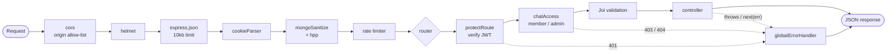
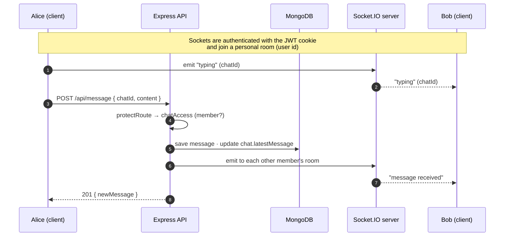
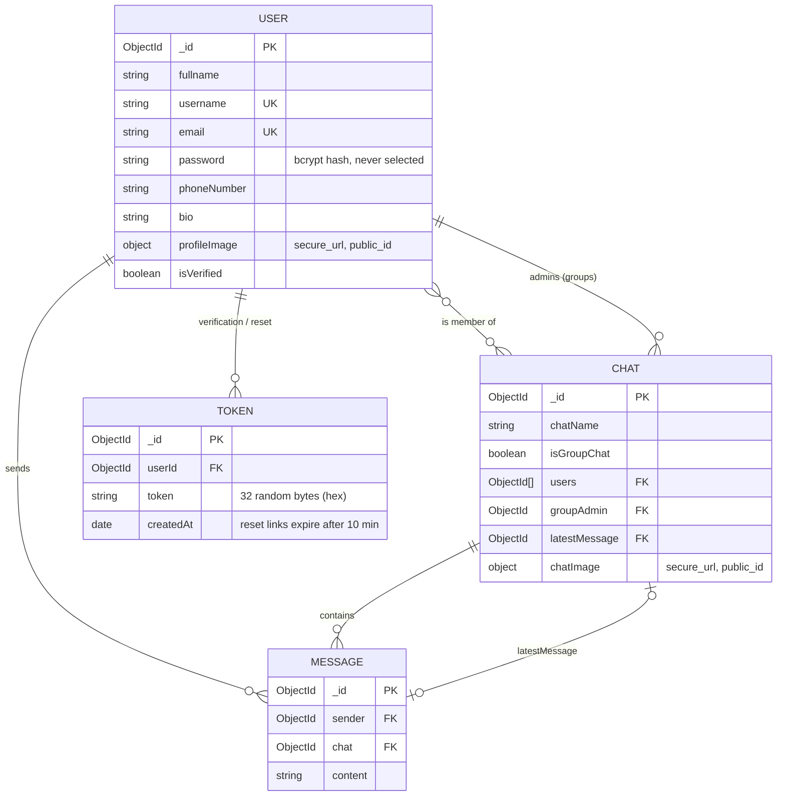

<div align="center">

# 💬 Chatify API

### Real-time chat backend: Node.js · Express · MongoDB · Socket.IO

A REST API + WebSocket server for authentication, user profiles, private & group chats, and real-time messaging


[**🚀 Quick Start**](#-getting-started) &nbsp;·&nbsp;
[**📋 Endpoints**](#-endpoints-at-a-glance) &nbsp;·&nbsp;
[**📡 API Reference**](#-api-reference) &nbsp;·&nbsp;
[**⚡ Socket Events**](#-socketio-events) &nbsp;·&nbsp;
[**🧪 Tests**](#-testing)

</div>

---

## 📑 Table of Contents

1. [Overview](#-overview)
2. [Tech Stack](#-tech-stack)
3. [Getting Started](#-getting-started)
4. [Environment Variables](#-environment-variables)
5. [Endpoints at a Glance](#-endpoints-at-a-glance)
6. [API Reference](#-api-reference)
   - [Conventions](#conventions)
   - [Response objects](#response-objects)
   - [Auth](#-auth-endpoints): 6 endpoints
   - [Users](#-user-endpoints): 6 endpoints
   - [Chats](#-chat-endpoints): 8 endpoints
   - [Messages](#-message-endpoints): 2 endpoints
   - [Health](#-health-endpoint): 1 endpoint
7. [Socket.IO Events](#-socketio-events)
8. [Architecture](#-architecture)
9. [Data Model](#-data-model)
10. [Security](#-security)
11. [Testing](#-testing)
12. [Project Structure](#-project-structure)
13. [Deployment](#-deployment)
14. [License](#-license) · [Author](#-author)

---

## 🔎 Overview

**Chatify API** is the backend of a real-time messaging application. It exposes **23 REST endpoints** and a **Socket.IO server**:

| Module | What it does |
| --- | --- |
| 🔐 **Auth** | Sign up, email verification, login/logout with an httpOnly JWT cookie, forgot/reset password by email |
| 👤 **Users** | Profile read/update, profile picture upload (compressed with Sharp, stored on Cloudinary), user search |
| 💬 **Chats** | Private chats (no duplicates), group chats with admin/member permissions |
| ✉️ **Messages** | Chat history and sending messages, delivered in real time to the other members |
| ⚡ **Real time** | Authenticated WebSocket, message delivery, typing indicators, online presence (multi-tab aware) |

**Engineering highlights**

- **Layered architecture**: routes → middlewares → controllers → services → models, with the Express `app` kept separate from the `server` so it can be tested
- **Authorization on every resource**: members-only chat/message access, admin-only group management
- **Centralized error handling**: one global handler, a consistent JSON error shape, no internal details leaked in production
- **Security hardening**: helmet, CORS allow-list, rate limiting, NoSQL-injection sanitization, regex-safe search, upload limits
- **34 integration tests** (HTTP + WebSocket) on an in-memory MongoDB; **0 known vulnerabilities** in production dependencies

---

## 🧰 Tech Stack

| Category | Technology |
| --- | --- |
| Runtime & framework | **Node.js ≥ 20**, **Express 4** |
| Real time | **Socket.IO 4** |
| Database | **MongoDB** + **Mongoose 8** |
| Authentication | **jsonwebtoken**, **bcrypt**, cookie-parser |
| Validation | **Joi** |
| File uploads & images | **Multer**, **Sharp**, **Cloudinary** |
| Email | **Nodemailer** |
| Security | helmet, cors, express-rate-limit, express-mongo-sanitize, hpp |
| Testing | **Jest**, **Supertest**, mongodb-memory-server, socket.io-client |
| Code quality | ESLint, Prettier |

---

## 🚀 Getting Started

### Prerequisites

- **Node.js 20+**
- **MongoDB** (local, [Atlas](https://www.mongodb.com/atlas), or Docker)
- *Optional:* a [Cloudinary](https://cloudinary.com/) account (images) and an SMTP account, e.g. a Gmail [App Password](https://support.google.com/accounts/answer/185833) (emails)

### Setup

```bash
# 1. Install dependencies
npm install

# 2. Start MongoDB (or use your own / Atlas)
docker run -d --name chatify-mongo -p 27017:27017 mongo:7

# 3. Configure the environment
cp .env.example .env          # set at least DATABASE_URL and JWT_SECRET

# 4. Run
npm run dev                   # http://localhost:5000 (auto-reload)
```

### Verify it works

```bash
curl http://localhost:5000/api/health
# {"status":"ok","database":"up","uptime":3}
```

### Scripts

| Command | Description |
| --- | --- |
| `npm run dev` | Start with auto-reload (`node --watch`) |
| `npm start` | Start in production mode |
| `npm test` | Run the integration test suite |
| `npm run lint` | Lint with ESLint |

---

## 🔐 Environment Variables

| Variable | Required | Default | Description |
| --- | :---: | --- | --- |
| `DATABASE_URL` | ✅ | | MongoDB connection string |
| `JWT_SECRET` | ✅ | | Secret used to sign auth tokens (long random string) |
| `NODE_ENV` | | | `development` returns error stacks; `production` uses `Secure; SameSite=None` cookies |
| `PORT` | | `5000` | Server port |
| `BASE_URL` | | | Client URL used in email links (verification / password reset) |
| `CLIENT_URL` | | `BASE_URL` | Comma-separated origins allowed by CORS and Socket.IO |
| `COOKIE_EXPIRES` | | `15d` | JWT lifetime |
| `BCRYPT_SALT` | | `10` | bcrypt cost factor |
| `EMAIL_SERVICE` | | | Nodemailer [well-known service](https://nodemailer.com/smtp/well-known/), e.g. `gmail` |
| `EMAIL_HOST` / `EMAIL_PORT` / `EMAIL_SECURE` | | — / `587` / `false` | SMTP settings when not using `EMAIL_SERVICE` |
| `EMAIL_USER` / `EMAIL_PASSWORD` | | | SMTP credentials (sender address) |
| `CLOUDINARY_CLOUD_NAME` / `CLOUDINARY_API_KEY` / `CLOUDINARY_API_SECRET` | | | Cloudinary credentials |

> [!IMPORTANT]
> Server start-up fails fast if `DATABASE_URL` or `JWT_SECRET` is missing. Use the `EMAIL_*` names, not `USER`/`HOST`, which clash with OS variables (`dotenv` never overrides them).

---

## 📋 Endpoints at a Glance

> 🔓 Public · 🔒 Requires login (auth cookie) · 👥 Chat member · 👑 Group admin · ⏱ Strict rate limit

| # | Method | Endpoint | Access | Description |
| :-: | --- | --- | :-: | --- |
| **Auth** | | | | |
| 1 | `POST` | `/api/auth/signup` | 🔓 ⏱ | Register a new account |
| 2 | `GET` | `/api/auth/:id/verify/:token` | 🔓 | Verify email address |
| 3 | `POST` | `/api/auth/login` | 🔓 ⏱ | Log in, sets the auth cookie |
| 4 | `POST` | `/api/auth/logout` | 🔓 | Log out, clears the auth cookie |
| 5 | `POST` | `/api/auth/forget-password` | 🔓 ⏱ | Request a password-reset email |
| 6 | `POST` | `/api/auth/reset-password/:id/:token` | 🔓 ⏱ | Set a new password |
| **Users** | | | | |
| 7 | `GET` | `/api/user/profile` | 🔒 | Get my profile |
| 8 | `PATCH` | `/api/user/profile` | 🔒 | Update my profile |
| 9 | `POST` | `/api/user/profile-image` | 🔒 | Upload profile picture |
| 10 | `DELETE` | `/api/user/profile-image` | 🔒 | Remove profile picture |
| 11 | `GET` | `/api/user/find?search=` | 🔒 | Search users |
| 12 | `GET` | `/api/user/conversations` | 🔒 | List all other users |
| **Chats** | | | | |
| 13 | `GET` | `/api/chat` | 🔒 | List my chats |
| 14 | `POST` | `/api/chat` | 🔒 | Open or create a private chat |
| 15 | `POST` | `/api/chat/create-group` | 🔒 | Create a group chat |
| 16 | `PATCH` | `/api/chat/rename-group` | 👥 | Rename a group |
| 17 | `PATCH` | `/api/chat/update-image` | 👥 | Change a group's image |
| 18 | `PATCH` | `/api/chat/add-user` | 👑 | Add a member to a group |
| 19 | `PATCH` | `/api/chat/remove-user` | 👑 / self | Remove a member, or leave a group |
| 20 | `POST` | `/api/chat/delete-group` | 👑 | Delete a group and its messages |
| **Messages** | | | | |
| 21 | `GET` | `/api/message/:chatId` | 👥 | Get chat history |
| 22 | `POST` | `/api/message` | 👥 | Send a message (real-time delivery) |
| **System** | | | | |
| 23 | `GET` | `/api/health` | 🔓 | Health check |

---

## 📡 API Reference

### Conventions

| | |
| --- | --- |
| **Base URL** | `http://localhost:5000` |
| **Request format** | `application/json`; image uploads use `multipart/form-data` |
| **Authentication** | `POST /api/auth/login` sets an **httpOnly `token` cookie**. Send it with every 🔒 request: browsers use `credentials: 'include'` / `withCredentials: true`; curl uses `-c cookies.txt` to save and `-b cookies.txt` to send |
| **Success responses** | JSON, documented per endpoint below |
| **Error responses** | `{ "status": "fail" \| "error", "message": "..." }`. In development a `stack` field is added |
| **Validation errors** | `{ "status": "fail", "errors": [{ "message", "path", "type", "context" }] }` |

#### Status codes

| Code | Meaning |
| --- | --- |
| `200` | OK |
| `201` | Created |
| `400` | Bad request: validation failed, malformed JSON, invalid id |
| `401` | Unauthenticated: no/invalid/expired token, wrong credentials, unverified email |
| `403` | Forbidden: not a chat member / not the group admin |
| `404` | Not found |
| `413` | Payload too large (JSON body > 10 KB) |
| `429` | Too many requests (rate limit) |
| `500` | Unexpected server error (no details in production) |
| `502` | Image provider (Cloudinary) failed |

#### Errors common to every 🔒 endpoint

| Status | Message | When |
| :-: | --- | --- |
| `401` | `Unauthorized - No Token Provided` | No `token` cookie |
| `401` | `Invalid token, please log in again` | Tampered / invalid token |
| `401` | `Your session has expired, please log in again` | Token expired |
| `401` | `The user belonging to this token no longer exists` | User was deleted |
| `429` | `Too many requests, try again later.` | > 1,000 requests / 15 min / IP |

#### Chat access errors

| Status | Message | When |
| :-: | --- | --- |
| `400` | `A valid chat id is required` | `chatId` missing or not an ObjectId |
| `404` | `Chat not found` | No chat with this id |
| `403` | `You are not a member of this chat` | Caller isn't in `chat.users` |
| `400` | `This action is only for group chats` | Group action on a private chat |
| `403` | `Only the group admin can do this` | 👑 action by a non-admin |

---

### Response objects

These objects appear in the responses below.

<details open>
<summary><b>User</b></summary>

```json
{
  "_id": "6650f1c2a1b2c3d4e5f60789",
  "fullname": "Jane Developer",
  "username": "janedev1",
  "email": "jane@example.com",
  "phoneNumber": "+20 1000000000",
  "bio": "Backend engineer",
  "profileImage": {
    "secure_url": "https://res.cloudinary.com/<cloud>/image/upload/v1716/Chatify-profiles/abc.jpg",
    "public_id": "Chatify-profiles/abc"
  },
  "isVerified": true,
  "createdAt": "2024-05-24T10:00:00.000Z",
  "updatedAt": "2024-05-24T10:00:00.000Z"
}
```

> The `password` field is **never** included in any response.

</details>

<details>
<summary><b>Chat</b></summary>

```json
{
  "_id": "6650f2d3a1b2c3d4e5f60790",
  "chatName": "Project Team",
  "isGroupChat": true,
  "users": [ "<User>", "<User>", "<User>" ],
  "groupAdmin": "<User>",
  "latestMessage": "<Message>",
  "chatImage": { "secure_url": "", "public_id": "" },
  "createdAt": "2024-05-24T10:01:00.000Z",
  "updatedAt": "2024-05-24T10:05:00.000Z"
}
```

| Field | Notes |
| --- | --- |
| `chatName` | Group name. Private chats use the default `"sender"`, so clients show the other user's name instead |
| `users` | Populated `User` objects |
| `groupAdmin` | Populated `User`, groups only |
| `latestMessage` | Populated in `GET /api/chat` (with `sender`), used for the chat-list preview |

</details>

<details>
<summary><b>Message</b></summary>

```json
{
  "_id": "6650f3e4a1b2c3d4e5f60791",
  "sender": {
    "_id": "6650f1c2a1b2c3d4e5f60789",
    "username": "janedev1",
    "email": "jane@example.com",
    "profileImage": { "secure_url": "", "public_id": "" }
  },
  "content": "Hello there 👋",
  "chat": "<Chat>",
  "createdAt": "2024-05-24T10:05:00.000Z",
  "updatedAt": "2024-05-24T10:05:00.000Z"
}
```

</details>

---

### 🔐 Auth Endpoints

#### 1. Sign up

`POST /api/auth/signup` · 🔓 Public · ⏱ 20 req / 15 min

Creates an **unverified** account and emails a verification link to `BASE_URL/auth/:id/verify/:token`.

**Request body**

| Field | Type | Required | Rules |
| --- | --- | :-: | --- |
| `fullname` | string | ✅ | At least 8 characters |
| `username` | string | ✅ | 6+ letters followed by digits/symbols (e.g. `janedev1`), unique |
| `email` | string | ✅ | Valid email, unique |
| `password` | string | ✅ | Starts with uppercase, 5+ letters/digits, ends with one of `@#$%^&*` (e.g. `Password1@`) |
| `confirmPassword` | string | ✅ | Must equal `password` |

> Unknown fields (e.g. `isVerified`) are **rejected**, which protects against mass assignment.

```bash
curl -X POST http://localhost:5000/api/auth/signup \
  -H "Content-Type: application/json" \
  -d '{"fullname":"Jane Developer","username":"janedev1","email":"jane@example.com","password":"Password1@","confirmPassword":"Password1@"}'
```

**Response `201`**

```json
{ "message": "Please verify your email address" }
```

**Errors**

| Status | Message | When |
| :-: | --- | --- |
| `400` | `{ "status": "fail", "errors": [...] }` | Validation failed (see example below) |
| `400` | `User already exists` | Email already registered |
| `400` | `Duplicate username value, please choose unique value` | Username taken |

<details>
<summary>Validation error example</summary>

```json
{
  "status": "fail",
  "errors": [
    {
      "message": "password\" must start with Uppercase and includes special character.",
      "path": ["password"],
      "type": "string.pattern.base"
    }
  ]
}
```

</details>

---

#### 2. Verify email

`GET /api/auth/:id/verify/:token` · 🔓 Public

Marks the account as verified and deletes the one-time token. Calling it again after success is **harmless** (email scanners and double clicks are common).

| Param | Description |
| --- | --- |
| `id` | User id from the email link |
| `token` | Verification token from the email link |

**Response `200`**

```json
{ "message": "Email verified successfully" }
```

```json
{ "message": "Email already verified" }
```

**Errors**

| Status | Message | When |
| :-: | --- | --- |
| `400` | `Invalid link` | No user with this id |
| `400` | `Invalid or expired link` | Token doesn't match |
| `400` | `Invalid _id with value ...` | `id` isn't a valid ObjectId |

---

#### 3. Log in

`POST /api/auth/login` · 🔓 Public · ⏱ 20 req / 15 min

Validates the credentials and sets the `token` cookie (httpOnly, 15 days).

| Field | Type | Required |
| --- | --- | :-: |
| `email` | string | ✅ |
| `password` | string | ✅ |

```bash
curl -X POST http://localhost:5000/api/auth/login -c cookies.txt \
  -H "Content-Type: application/json" \
  -d '{"email":"jane@example.com","password":"Password1@"}'
```

**Response `200`**

```http
Set-Cookie: token=eyJhbGciOi...; Max-Age=1296000; Path=/; HttpOnly; SameSite=Lax
```

```json
{
  "status": "success",
  "user": "<User>"
}
```

> In production the cookie is `Secure; SameSite=None` so cross-site clients can use it.

**Errors**

| Status | Message | When |
| :-: | --- | --- |
| `400` | `Please provide email and password` | A field is missing |
| `401` | `Invalid email or password` | Wrong credentials (same message for both cases) |
| `401` | `Please verify your email!` | Account not verified yet |

---

#### 4. Log out

`POST /api/auth/logout` · 🔓 Public

Clears the `token` cookie.

**Response `200`**

```json
{ "message": "Logged out successfully" }
```

---

#### 5. Forgot password

`POST /api/auth/forget-password` · 🔓 Public · ⏱ 20 req / 15 min

If the email is registered, invalidates any previous token and emails a reset link to `BASE_URL/auth/reset-password/:id/:token`. The response is **identical whether or not the email exists**, which prevents account enumeration.

| Field | Type | Required |
| --- | --- | :-: |
| `email` | string | ✅ |

**Response `200`**

```json
{
  "status": "success",
  "message": "If this email is registered, a reset link has been sent!"
}
```

**Errors**

| Status | Message | When |
| :-: | --- | --- |
| `400` | `Please provide your email` | `email` missing |

---

#### 6. Reset password

`POST /api/auth/reset-password/:id/:token` · 🔓 Public · ⏱ 20 req / 15 min

Sets a new password. The link works **once** and expires after **10 minutes**.

| Field | Type | Required | Rules |
| --- | --- | :-: | --- |
| `newPassword` | string | ✅ | Same rules as the sign-up password |
| `confirmNewPassword` | string | ✅ | Must equal `newPassword` |

**Response `200`**

```json
{ "status": "success", "message": "Password updated successfully!" }
```

**Errors**

| Status | Message | When |
| :-: | --- | --- |
| `404` | `Invalid link - user not found!` | No user with this id |
| `401` | `Invalid link` | Token wrong, already used or expired |
| `400` | `{ "status": "fail", "errors": [...] }` | Password rules not met / passwords don't match |

---

### 👤 User Endpoints

#### 7. Get my profile

`GET /api/user/profile` · 🔒 Logged in

**Response `200`**

```json
{ "user": "<User>" }
```

---

#### 8. Update my profile

`PATCH /api/user/profile` · 🔒 Logged in

Send only the fields to change. Empty `fullname` / `username` are ignored; `bio` and `phoneNumber` can be cleared with `""`. Other fields (email, password, `isVerified`, …) are rejected.

| Field | Type | Rules |
| --- | --- | --- |
| `fullname` | string | At least 8 characters |
| `username` | string | Same pattern as sign-up, unique |
| `phoneNumber` | string | |
| `bio` | string | |

```bash
curl -X PATCH http://localhost:5000/api/user/profile -b cookies.txt \
  -H "Content-Type: application/json" \
  -d '{"bio":"Backend engineer"}'
```

**Response `200`**

```json
{
  "status": "success",
  "message": "data updated successfully",
  "updatedUser": "<User>"
}
```

**Errors**

| Status | Message | When |
| :-: | --- | --- |
| `400` | `{ "status": "fail", "errors": [...] }` | Validation failed / unknown field |
| `400` | `Duplicate username value, please choose unique value` | Username taken |

---

#### 9. Upload profile picture

`POST /api/user/profile-image` · 🔒 Logged in · `multipart/form-data`

The image is auto-rotated, resized to at most 1000px wide, compressed to JPEG (80%) and uploaded to Cloudinary. The previous picture is deleted.

| Field | Type | Required | Rules |
| --- | --- | :-: | --- |
| `profileImage` | file | ✅ | Image MIME type, ≤ 5 MB |

```bash
curl -X POST http://localhost:5000/api/user/profile-image -b cookies.txt \
  -F "profileImage=@./avatar.png"
```

**Response `200`**

```json
{ "status": "success", "user": "<User>" }
```

**Errors**

| Status | Message | When |
| :-: | --- | --- |
| `400` | `No image provided` | No file sent |
| `400` | `Only image files are allowed` | Not an image |
| `400` | `File too large` | Larger than 5 MB |
| `502` | `Image upload failed, please try again` | Cloudinary error |

---

#### 10. Remove profile picture

`DELETE /api/user/profile-image` · 🔒 Logged in

Deletes the image from Cloudinary and clears `profileImage`.

**Response `200`**

```json
{
  "status": "success",
  "message": "Image deleted successfully",
  "user": "<User>"
}
```

---

#### 11. Search users

`GET /api/user/find?search=<text>` · 🔒 Logged in

Case-insensitive partial match on **username or email**. The input is matched literally (regex characters are escaped). Returns at most **20** users and never includes the caller.

| Query | Description |
| --- | --- |
| `search` | Text to search for. Empty → `[]` |

```bash
curl "http://localhost:5000/api/user/find?search=jane" -b cookies.txt
```

**Response `200`**

```json
[
  {
    "_id": "6650f1c2a1b2c3d4e5f60789",
    "fullname": "Jane Developer",
    "username": "janedev1",
    "email": "jane@example.com",
    "profileImage": { "secure_url": "", "public_id": "" }
  }
]
```

---

#### 12. List other users

`GET /api/user/conversations` · 🔒 Logged in

Returns every user except the caller.

**Response `200`**

```json
[ "<User>", "<User>" ]
```

---

### 💬 Chat Endpoints

#### 13. List my chats

`GET /api/chat` · 🔒 Logged in

All chats the caller belongs to, **most recently active first**, with `users`, `groupAdmin` and `latestMessage` (+ its `sender`) populated.

**Response `200`**

```json
{ "populatedChats": [ "<Chat>", "<Chat>" ] }
```

---

#### 14. Open or create a private chat

`POST /api/chat` · 🔒 Logged in

Returns the **existing** private chat between the caller and `userId`, or creates it. There's never more than one private chat per pair of users.

| Field | Type | Required |
| --- | --- | :-: |
| `userId` | ObjectId | ✅ |

**Response `200`** (already exists) / **`201`** (created)

```json
{ "newChatWithPopulated": "<Chat>" }
```

**Errors**

| Status | Message | When |
| :-: | --- | --- |
| `400` | `A valid user id is required` | Missing / invalid `userId` |
| `400` | `You cannot start a chat with yourself` | `userId` is the caller |
| `404` | `User not found` | No such user |

---

#### 15. Create a group

`POST /api/chat/create-group` · 🔒 Logged in · `multipart/form-data`

Creates a group with the caller as **admin**. Member ids are de-duplicated and the caller is added automatically.

| Field | Type | Required | Rules |
| --- | --- | :-: | --- |
| `groupName` | string | ✅ | Non-empty |
| `users` | string | ✅ | Comma-separated user ids, **at least 2 other users** |
| `groupImage` | file | | Image, ≤ 5 MB |

```bash
curl -X POST http://localhost:5000/api/chat/create-group -b cookies.txt \
  -F "groupName=Project Team" \
  -F "users=6650f1c2a1b2c3d4e5f60790,6650f1c2a1b2c3d4e5f60791" \
  -F "groupImage=@./team.png"
```

**Response `201`**: the created `<Chat>` (not wrapped)

**Errors**

| Status | Message | When |
| :-: | --- | --- |
| `400` | `Please fill all the fields` | Missing `groupName` or `users` |
| `400` | `Invalid user id provided` | An id isn't a valid ObjectId |
| `400` | `At least 2 other users are required to form a group chat` | Too few members |
| `404` | `Some of the selected users do not exist` | Unknown user id |
| `502` | `Image upload failed, please try again` | Cloudinary error |

---

#### 16. Rename a group

`PATCH /api/chat/rename-group` · 👥 Group member

| Field | Type | Required |
| --- | --- | :-: |
| `chatId` | ObjectId | ✅ |
| `chatName` | string | ✅ |

**Response `200`**

```json
{ "updatedChat": "<Chat>" }
```

**Errors:** [chat access errors](#chat-access-errors), plus `400 Group name is required`.

---

#### 17. Change group image

`PATCH /api/chat/update-image` · 👥 Group member · `multipart/form-data`

| Field | Type | Required |
| --- | --- | :-: |
| `chatId` | ObjectId | ✅ |
| `chatImage` | file | ✅ (image, ≤ 5 MB) |

**Response `200`**

```json
{ "updatedChat": "<Chat>" }
```

**Errors:** [chat access errors](#chat-access-errors), plus `400 No image provided`, `400 Only image files are allowed`, `502 Image upload failed, please try again`.

---

#### 18. Add a member

`PATCH /api/chat/add-user` · 👑 Group admin

| Field | Type | Required |
| --- | --- | :-: |
| `chatId` | ObjectId | ✅ |
| `userId` | ObjectId | ✅ |

**Response `200`**

```json
{ "updatedChat": "<Chat>" }
```

**Errors:** [chat access errors](#chat-access-errors), plus:

| Status | Message | When |
| :-: | --- | --- |
| `404` | `User not found` | Invalid / unknown `userId` |
| `400` | `User already in group chat` | Already a member |

---

#### 19. Remove a member / leave a group

`PATCH /api/chat/remove-user` · 👑 Group admin, or 👥 a member removing **themselves**

| Field | Type | Required |
| --- | --- | :-: |
| `chatId` | ObjectId | ✅ |
| `userId` | ObjectId | ✅ (your own id to leave) |

**Response `200`**

```json
{ "updatedChat": "<Chat>" }
```

**Errors:** [chat access errors](#chat-access-errors), plus:

| Status | Message | When |
| :-: | --- | --- |
| `403` | `Only the group admin can remove users` | A member tries to remove someone else |
| `400` | `Cannot remove group admin` | Target is the admin |

---

#### 20. Delete a group

`POST /api/chat/delete-group` · 👑 Group admin

Deletes the group, **all its messages**, and its image.

| Field | Type | Required |
| --- | --- | :-: |
| `chatId` | ObjectId | ✅ |

**Response `200`**

```json
{ "message": "Group deleted successfully" }
```

**Errors:** [chat access errors](#chat-access-errors).

---

### ✉️ Message Endpoints

#### 21. Get chat history

`GET /api/message/:chatId` · 👥 Chat member

All messages of the chat, **oldest first**, with `sender` and `chat` populated.

```bash
curl http://localhost:5000/api/message/6650f2d3a1b2c3d4e5f60790 -b cookies.txt
```

**Response `200`**

```json
{ "messages": [ "<Message>", "<Message>" ] }
```

**Errors:** [chat access errors](#chat-access-errors). Outsiders get `403 You are not a member of this chat`.

---

#### 22. Send a message

`POST /api/message` · 👥 Chat member

Saves the message, updates the chat's `latestMessage`, and **pushes it in real time** (`message received` socket event) to every other member of the chat.

| Field | Type | Required | Rules |
| --- | --- | :-: | --- |
| `chatId` | ObjectId | ✅ | A chat you belong to |
| `content` | string | ✅ | Non-empty after trimming, ≤ 5,000 characters |

```bash
curl -X POST http://localhost:5000/api/message -b cookies.txt \
  -H "Content-Type: application/json" \
  -d '{"chatId":"6650f2d3a1b2c3d4e5f60790","content":"Hello there 👋"}'
```

**Response `201`**

```json
{ "newMessage": "<Message>" }
```

**Errors:** [chat access errors](#chat-access-errors), plus:

| Status | Message | When |
| :-: | --- | --- |
| `400` | `Message content is required` | Empty / whitespace-only |
| `400` | `Message is longer than 5000 characters` | Too long |

---

### 🩺 Health Endpoint

#### 23. Health check

`GET /api/health` · 🔓 Public · not rate-limited

For uptime monitors and load-balancer health checks.

**Response `200`**

```json
{ "status": "ok", "database": "up", "uptime": 3605 }
```

`database` is `"down"` when the MongoDB connection is lost. Unknown routes return `404 Can't find <url> on this server!`.

---

## ⚡ Socket.IO Events

Clients connect to the same host as the API. The handshake is **authenticated with the `token` cookie**; without a valid one, the connection is rejected with `Unauthorized`. Each socket automatically joins a private room named after its user id, which is where `message received` is delivered.

```js
import { io } from 'socket.io-client';

const socket = io('http://localhost:5000', { withCredentials: true });

socket.on('connect_error', (err) => console.log(err.message)); // "Unauthorized"
socket.on('getOnlineUsers', (userIds) => {});
socket.on('message received', (message) => {});
socket.on('typing', (chatId) => {});
socket.on('stop typing', (chatId) => {});

socket.emit('join chat', chatId);
socket.emit('typing', chatId);
socket.emit('stop typing', chatId);
```

| Direction | Event | Payload | Description |
| --- | --- | --- | --- |
| client → server | `join chat` | `chatId` | Join a chat room to receive its typing events (**members only**, otherwise ignored) |
| client → server | `typing` | `chatId` | Notify the chat that I'm typing |
| client → server | `stop typing` | `chatId` | Notify the chat that I stopped typing |
| server → client | `getOnlineUsers` | `string[]` | Online user ids, broadcast on every connect/disconnect (multi-tab aware) |
| server → client | `message received` | `<Message>` | New message in one of my chats (sent by the API after `POST /api/message`) |
| server → client | `typing` | `chatId` | Someone is typing in that chat |
| server → client | `stop typing` | `chatId` | They stopped typing |

---

## 🏗 Architecture

### Request lifecycle



- Controllers are wrapped in `catchAsync`, so every async error reaches the **global error handler**.
- The handler maps known errors (invalid ObjectId, duplicate key, Mongoose validation, JWT, Multer, malformed JSON) to clean `4xx` responses. Unknown errors are logged and returned as a generic `500` in production.

### Real-time message flow



> **Why the server broadcasts:** clients never relay message payloads to each other. Only messages that were authorized and saved by the API are delivered, so messages can't be spoofed.

---

## 🗃 Data Model



| Collection | Notes |
| --- | --- |
| `users` | `username` & `email` unique; `password` has `select: false`; timestamps |
| `chats` | Private and group chats in one collection (`isGroupChat`); timestamps (`updatedAt` sorts the chat list) |
| `messages` | Compound index `{ chat: 1, createdAt: 1 }` for ordered history; timestamps |
| `tokens` | One-time verification / reset tokens; a new reset request invalidates older ones |

---

## 🛡 Security

| Threat | Mitigation |
| --- | --- |
| Token theft via XSS | JWT in an **httpOnly** cookie; `Secure` + `SameSite=None` in production, `SameSite=Lax` locally |
| Password exposure | bcrypt hashing; password never selected or returned |
| Accessing other users' chats (IDOR) | `chatAccess` middleware: **membership** check on every chat/message route, **admin** check for group management |
| Message spoofing | Authenticated socket handshake; messages emitted **by the server** after authorization |
| Mass assignment | Joi rejects unknown fields; explicit field whitelists on create/update |
| NoSQL injection | `express-mongo-sanitize`, ObjectId validation |
| ReDoS / regex injection | Search input escaped, results capped at 20 |
| Brute force | 20 req / 15 min on auth endpoints, 1,000 req / 15 min on the API |
| Account enumeration | Identical "forgot password" response for known and unknown emails; same login error for wrong email or password |
| Oversized / malicious payloads | 10 KB JSON limit, image-only uploads ≤ 5 MB, `hpp` |
| Common web attacks | `helmet` security headers; CORS + Socket.IO origin allow-list |
| Information disclosure | No stack traces or internal messages in production |
| Vulnerable dependencies | `npm audit --omit=dev`: **0 vulnerabilities** |

---

## 🧪 Testing

**34 integration tests** boot the real Express app and Socket.IO server against an **in-memory MongoDB**. Email and Cloudinary are mocked, so no `.env` or external services are needed.

```bash
npm test
```

```
PASS tests/auth.test.js
PASS tests/chat.test.js
PASS tests/socket.test.js

Test Suites: 3 passed, 3 total
Tests:       34 passed, 34 total
```

| Suite | Endpoints / behavior covered |
| --- | --- |
| `auth.test.js` | Health check, 404 route, malformed JSON, signup validation & mass-assignment protection, email verification (idempotent, bad token), login (cookie set, password never returned), protected routes, logout, forgot password (no enumeration), reset password (single use), profile update, regex-safe search |
| `chat.test.js` | Private chat create/reuse, invalid & self chat, send/read messages (trimmed, ordered), empty message, latest-message preview, **non-members get 403**, group creation rules, rename by member, add by admin only, leave vs remove, admin can't be removed, delete group (admin only, messages deleted) |
| `socket.test.js` | Sockets without/with forged cookie rejected, `message received` delivered only to the other members, typing events only for chat members |

Run against a real MongoDB instead by setting `TEST_DATABASE_URL`. Lint with `npm run lint`.

---

## 📂 Project Structure

```
backend/
├── app.js                   # Express app: middleware, routes, 404, error handler
├── server.js                # Entry: env check, DB connect, HTTP + Socket.IO, graceful shutdown
├── socket/index.js          # Socket auth, presence, rooms, typing events
├── config/                  # DB connection, CORS origin allow-list
├── routes/                  # auth · user · chat · message routers
├── middlewares/
│   ├── protectRoute.js      # JWT cookie → req.user
│   ├── chatAccess.js        # Membership / admin authorization
│   ├── findChat.js          # Re-use existing private chat
│   ├── groupValidator.js    # Group members validation
│   ├── resetMiddleware.js   # Reset-link validation
│   ├── validation.js        # Joi validator
│   ├── rateLimiters.js      # API & auth rate limits
│   └── multer.js            # Image uploads (≤5MB)
├── controllers/             # auth · user · chat · message · error
├── models/                  # User · Chat · Message · Token
├── services/                # Cloudinary · Nodemailer
├── utils/                   # AppError, catchAsync, Joi schemas, email templates, JWT cookie, image compression
├── tests/                   # Jest + Supertest + Socket.IO integration tests
└── .env.example
```

---

## ☁️ Deployment

Runs on any Node.js host (Render, Railway, Fly.io, a VPS, …).

| Setting | Value |
| --- | --- |
| Build command | `npm install` |
| Start command | `npm start` |
| Health check path | `/api/health` |
| Node version | 20+ |

```env
NODE_ENV=production
DATABASE_URL=mongodb+srv://<user>:<password>@<cluster>/chatify
JWT_SECRET=<long-random-string>
BASE_URL=https://your-client.example.com
CLIENT_URL=https://your-client.example.com
EMAIL_SERVICE=gmail
EMAIL_USER=<sender@gmail.com>
EMAIL_PASSWORD=<app-password>
CLOUDINARY_CLOUD_NAME=...
CLOUDINARY_API_KEY=...
CLOUDINARY_API_SECRET=...
```

> [!TIP]
> Production cookies are `Secure` (HTTPS required). If the client is on a different site than the API, browsers treat the cookie as third-party. Hosting both on the same domain (e.g. `app.example.com` and `api.example.com`) avoids that.

---

## 📄 License

Licensed under the **ISC License**.

## 👤 Author

**Mahmoud Samir**: [GitHub @MahmoudSamir97](https://github.com/MahmoudSamir97)
